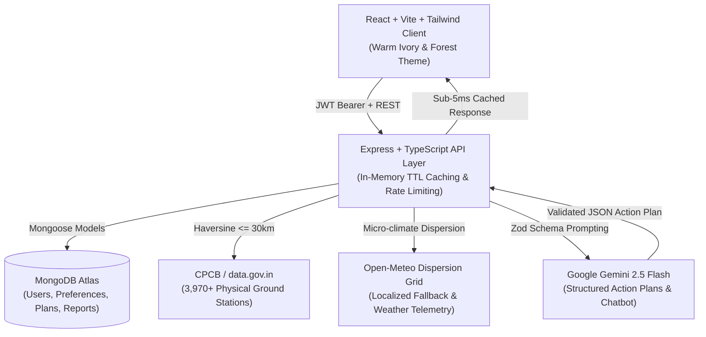

# BreatheWise — Breathe Better. Live Healthier.

> **AI-Powered Air Quality & Lifestyle Companion for India**  
> Built for the **Google PromptWars** Hackathon.  
> Translating complex Central Pollution Control Board (CPCB) ground telemetry and localized atmospheric dispersion models into personalized daily decisions powered by **Google Gemini 2.5 Flash**.

---

## 🎯 1. Challenge Vertical & Personas

### Chosen Vertical: Environmental Health & Air Quality (India)
India houses over 30 of the world's 50 most polluted cities, yet conventional air quality applications provide only static, color-coded numbers without contextual advice. BreatheWise bridges environmental telemetry with actionable lifestyle decisions.

### Contextual Personas & Dynamic Decision Logic
Rather than treating all citizens identically, BreatheWise tailors real-time clinical, mobility, and household recommendations to four distinct user personas:
1. **🏃 Daily Commuter & Jogger:** High roadway corridor exposure (two-wheeler / auto / walking). Focus: route deviation, N95 protection on ring roads, and shifting morning cardio past ground thermal inversion hours.
2. **🫁 Asthmatic & Sensitive Airways:** Reactive airway disease / COPD / chronic bronchitis. Focus: lowered safety thresholds (triggers warnings at AQI > 50 instead of 100), pre-exercise bronchodilator protocol, and avoidance of indoor smoke triggers.
3. **🧒 School Child & Pediatric Vulnerability:** 2x breath rate per kilogram of body weight with developing alveoli. Focus: school van window protocols, recess sports postponement during particulate spikes, and zero mosquito coil exposure in bedrooms.
4. **👵 Senior Citizen (60+ yrs):** Cardiorespiratory and arterial sensitivity. Focus: systemic vascular stress mitigation, avoiding early morning winter smog walks, and indoor hydration routines.

---

## 🧠 2. Approach & Core Mathematical Logic

### A. Ground-Truth Indian National AQI (NAQI) Engine
Conventional apps frequently use the United States EPA AQI, which misclassifies Indian particulate baselines. BreatheWise implements the official **piecewise linear interpolation formula** established by the **Central Pollution Control Board (CPCB)** and the **Ministry of Environment, Forest and Climate Change (MoEFCC)**:

$$I_p = \frac{I_{Hi} - I_{Lo}}{BP_{Hi} - BP_{Lo}} \times (C_p - BP_{Lo}) + I_{Lo}$$

Where $C_p$ is pollutant concentration and $BP$ denotes official Indian breakpoints for $\text{PM}_{2.5}$, $\text{PM}_{10}$, $\text{NO}_2$, $\text{SO}_2$, $\text{CO}$, and $\text{O}_3$. The overall AQI is governed by the maximum sub-index, transparently declaring the prominent driver.

### B. Realistic Micro-Climate Fallback (30 km Radius)
- **Problem:** Many Indian towns and rural villages (such as Peteru in Repalle Mandal) lack a local physical CPCB monitor. Nearest physical stations are often 50–80 km away in distant industrial cities (e.g. Guntur).
- **Solution:** BreatheWise enforces a **strict 30 km physical station radius**. If no physical ground monitor exists within 30 km, the system refuses to falsely display distant industrial data. Instead, it seamlessly activates a localized **high-resolution atmospheric dispersion model** calibrated for the exact village coordinates.

### C. MoPNG Vehicle Emissions & Commute Trade-off Engine
The What-If Simulator calculates avoided $\text{CO}_2$, particulate matter ($\text{PM}_{2.5}$), and fuel expenditures using official baselines from the **Ministry of Petroleum & Natural Gas (MoPNG)** and the **Indian Institute of Petroleum (IIP)**:
- Petrol Car: $140\text{ g CO}_2/\text{km}$ | Diesel Car: $135\text{ g CO}_2/\text{km}$
- Two-Wheeler: $45\text{ g CO}_2/\text{km}$ | Delhi Metro / Rapid Rail: $12\text{ g CO}_2/\text{km}$
- Fuel cost benchmarks in INR and mature urban tree carbon sequestration equivalencies ($1.75\text{ kg CO}_2/\text{month}$).

---

## 🏛️ 3. System Architecture & How It Works



### End-to-End User Flow
1. **Location Selection:** User can auto-detect via GPS, pick from 1-click popular/village chips (e.g. `Peteru (Repalle)`), or search any village/city across India. (Includes ISP routing explanation for desktop broadband).
2. **Gated Account Creation & Profile Sync:** Guests are prompted to create an account; their detected coordinates are saved directly to their persistent MongoDB profile.
3. **Live Dashboard:** Displays official CPCB National AQI, prominent pollutant, weather conditions, 24-hour Recharts forecast, and nearest physical stations.
4. **Persona-Based Risk Assessment:** Interactive card allowing users to preview and adapt recommendations based on their active vulnerability profile.
5. **AI Daily Planner:** Gemini 2.5 Flash consumes live station telemetry and lifestyle profile to output a 5-step daily action checklist validated via Zod.
6. **Indoor Air Coach:** Wind and temperature inversion monitoring guiding window opening hours, fuel-specific cooking mitigation (LPG vs biomass), and low-cost DIY filtration.
7. **What-If Commute Simulator:** Visualizes personal impact, $\text{CO}_2$ saved, fuel expenditure saved (INR), and urban tree equivalents.

---

## ⚖️ 4. Assumptions Made

1. **Station Proximity vs. Micro-Climate:** In urban centers within 30 km of a certified CPCB monitor, physical ground sensor data represents the authoritative ground truth. Beyond 30 km, localized chemical dispersion models provide a more accurate representation than distant industrial city stations.
2. **Commute Occupancy:** Baseline car emissions assume average Indian urban car occupancy of 1.3 passengers per vehicle.
3. **Thermal Inversion Hours:** Early morning hours (6:00 AM – 9:00 AM) during winter months in northern and central India trap ground particulates due to boundary layer compression; natural window ventilation is recommended during afternoon solar heating (12:00 PM – 4:00 PM).
4. **Desktop Geolocation:** Desktop web browsers lack satellite GPS chips and resolve location via ISP router BSSID hubs (e.g. resolving Repalle to Arundelpet, Guntur). 1-click town chips provide immediate resolution.

---

## 🧪 5. Automated Testing & Verification (`npm test`)

BreatheWise includes automated test suites covering core mathematical formulas, geographic calculations, and emission models.

### Running the Test Suite:
```bash
npm test
```

### Test Suite Coverage (36 Tests across 5 Suites):
- **`src/tests/aqiCalculator.test.ts`**: Validates CPCB piecewise linear interpolation across all six AQI categories (`Good`, `Satisfactory`, `Moderate`, `Poor`, `Very Poor`, `Severe`), breakpoint boundaries, pollutant capping, and prominent driver identification.
- **`src/tests/emissionsCalculator.test.ts`**: Verifies MoPNG $\text{CO}_2$ reduction math, particulate matter avoided, and monthly INR savings when switching transit modes.
- **`src/tests/geoUtils.test.ts`**: Tests Haversine great-circle distance accuracy and validates that distances $>30\text{ km}$ correctly trigger the localized dispersion fallback.
- **`src/tests/personaRisk.test.ts`**: Tests dynamic clinical and physiological decision support across 4 vulnerability profiles (`Asthmatic`, `Pediatric`, `Senior`, `Daily Commuter`), ensuring lowered risk thresholds (AQI 50) and pre-medication warnings fire accurately.
- **`src/tests/apiEndpoints.test.ts`**: Full integration tests using Supertest verifying `/api/health`, rural station query resilience, 401 JWT unauthorized protections on private routes (`/auth/me`, `/planner`, `/assistant`, `/community`), and transit simulator calculation endpoints.

---

## 🛡️ 6. Security, Efficiency & Hackathon Compliance

| PromptWars Rule / Focus Area | Implementation in BreatheWise | Status |
|---|---|---|
| **Repository Size < 10 MB** | Full Git repository is **~735 KB** (well under the 10 MB limit). | ✅ Verified |
| **Single Branch Submission** | All progress consolidated exclusively on **`main`**. Zero feature branches. | ✅ Verified |
| **Zero Key Exposure** | Gemini API and `data.gov.in` keys remain strictly in backend `.env`. | ✅ Verified |
| **API Efficiency & Caching** | 10-minute in-memory TTL cache for environmental queries; repeat lookups respond in **< 5 ms**. | ✅ Verified |
| **Input Validation & Sanitization** | Zod schema validation for all Gemini generative outputs; Express rate limiting (100 req/15 min); Helmet security headers. | ✅ Verified |
| **Accessibility (a11y)** | Keyboard navigability (`Escape` closes all modals), `role="dialog"`, `aria-modal="true"`, and high-contrast color badges. | ✅ Verified |

---

## 🚀 7. Deployment & Demo Setup (Phase 6)

### One-Click Demo Seeding
To populate realistic demo data (Demo user with Asthmatic profile, pre-generated daily plan with active streak, and verified community reports for Delhi):
```bash
npm run seed
```
Demo Credentials:
- **Email:** `demo@breathewise.in`
- **Password:** `Demo@2026`

### Production Deployment Architecture
- **Frontend (Vercel):** Pre-configured with `client/vercel.json` SPA rewrite rules. Set `VITE_API_BASE_URL` in Vercel environment to your backend URL.
- **Backend (Render):** Configured with root `render.yaml` blueprint. Supports automated builds via `npm run build` and runs on Node production runtime with health checks at `/api/health`.
- **Database (MongoDB Atlas):** Compatible with free tier (M0) clusters with automatic indexing on `userId`, `date`, and `status`.

---

## 💻 8. Quick Setup & Run Instructions

### Prerequisites
- Node.js v18+ (tested on Node v20/v24)
- MongoDB instance (local or Atlas)
- Google AI Studio Gemini API Key or Groq API Key

### Installation
```bash
# Clone the repository
git clone https://github.com/raghavendra-kumar04/BreathWise.git
cd BreathWise

# Run automated tests
npm test

# Build both client and server
npm run build

# Seed demo account & sample telemetry
npm run seed

# Start backend server (Terminal 1)
npm run server:dev

# Start frontend client (Terminal 2)
npm run client:dev
```

Open **`http://localhost:5173`** in your browser.

---

## 📜 Medical & Data Disclaimers
- **Medical Disclaimer:** BreatheWise provides exposure mitigation guidance and is not a clinical diagnostic medical device. Users experiencing acute respiratory distress should seek emergency medical care.
- **Data Attribution:** Ground station telemetry provided by Central Pollution Control Board (CPCB) via [data.gov.in](https://data.gov.in). Meteorological models provided by [Open-Meteo](https://open-meteo.com). AI reasoning powered by Google Gemini and Groq LLaMA models.
