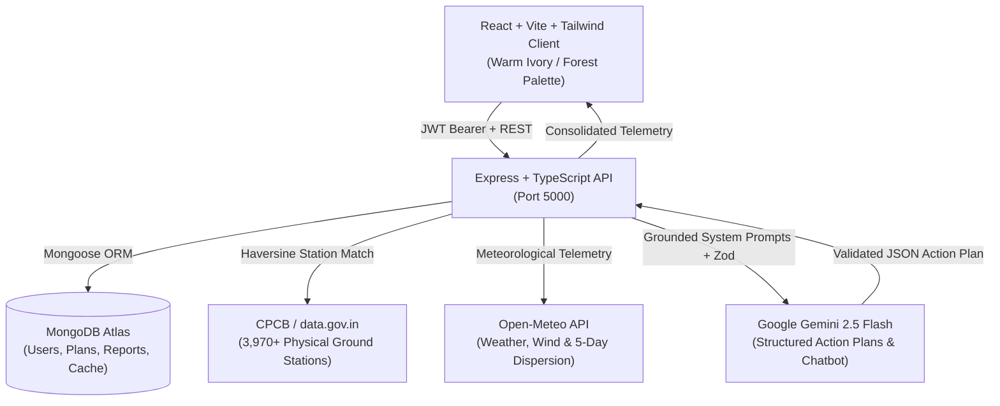

# BreatheWise — Breathe Better. Live Healthier.

> **AI-Powered Air Quality Companion for India**  
> Built for the **Google PromptWars** Hackathon.  
> Translating complex Central Pollution Control Board (CPCB) telemetry and Open-Meteo atmospheric dispersion models into personalized daily lifestyle decisions powered by **Google Gemini 2.5 Flash**.

---

## 🌿 Product Vision & Key Differentiator

Most air quality apps merely display a static color-coded AQI number. They don't explain **what that number means for your personal routine** or **what specific actions you can take today**.

**BreatheWise bridges environmental monitoring with daily human action:**
- **Ground Truth Grounding:** Fetches live station measurements directly from Government of India monitoring stations via `data.gov.in` (CPCB National AQI).
- **Zero Hallucination AI:** Google Gemini 2.5 Flash acts as an analytical reasoning engine over actual measurements, never fabricating pollution numbers.
- **Micro-Environment Protection:** Differentiates between indoor exposure (LPG vs biomass cooking, window ventilation timing) and roadway traffic corridors.
- **Citizen Science:** Crowdsourced neighborhood intelligence for localized hotspots (garbage burning, construction dust plumes).

---

## 🏛️ System Architecture

BreatheWise is structured as a **modular monolith** with clean separation between the React frontend client, Express API orchestration layer, MongoDB persistent store, and external environmental APIs:



---

## 📦 Project Modules

| Module | Core Responsibility | Key Technologies |
|---|---|---|
| **01. Air Quality Dashboard** | Live National AQI, pollutant breakdown (PM2.5, PM10, NO2, SO2, CO, O3), weather conditions, 24h & 5-day charts. | Recharts, CPCB data.gov.in, Open-Meteo |
| **02. AI Daily Planner** | Morning briefings, personalized outdoor exercise adjustments, commute advice, and checklist progress tracking. | Gemini 2.5 Flash, Zod, TanStack Query |
| **03. AI Assistant** | Context-aware chatbot grounded in live local station readings and household context. | Gemini 2.5 Flash, MongoDB Conversation History |
| **04. Indoor Air Coach** | Thermal inversion window ventilation timer, fuel-specific cooking mitigation (LPG/induction/chulha), and low-cost DIY tips. | Wind velocity models, CPCB standards |
| **05. Community Intel** | Crowdsourced local smoke, dust, and trash burning reports with upvoting and neighborhood landmark tags. | MongoDB Geo-indexing, Leaflet |
| **06. What-If Simulator** | Commute trade-offs modeling CO₂ reduction, road dust avoided, fuel costs saved (INR), and urban tree equivalencies. | MoPNG & CPCB mobile emission factors |
| **07. User Profile & Insights** | Lifestyle preferences editor (commute mode, activity, cooking fuel), longitudinal protection ledger, adherence rate. | React Hook Form, bcrypt, JWT |
| **08. Legal & Transparency** | Public Terms of Service, Medical & Diagnostic Disclaimers, and transparent Privacy Policy. | React Router SPA |

---

## 🗄️ Database Design (MongoDB)

1. **`User`**: Account credentials (bcrypt salt rounds ≥ 12), role (`user` / `admin`), and active geolocation coordinates.
2. **`UserPreferences`**: Personalized lifestyle parameters: `commuteMode` (Metro, Two-Wheeler, Car, Bus, WFH), `outdoorActivity`, `cookingFuel` (LPG, Induction, Biomass), `budget`, and notification preferences.
3. **`AirQualityRecord`**: Cached CPCB and Open-Meteo observations with 24-hour TTL index for fast response times.
4. **`DailyPlan`**: Stores today's Gemini-generated morning briefing, risk level, and task checklists per user per calendar day (`userId: 1, date: 1` compound index).
5. **`Conversation`**: Context-aware multi-turn chat threads with 30-day automatic expiration.
6. **`CommunityReport`**: Geotagged neighborhood pollution incidents with moderation state (`approved`, `pending`) and community upvotes.
7. **`ActivityLog`**: Historical milestones and cumulative avoided exposure hours.

---

## 🚀 Getting Started

### Prerequisites
- **Node.js** v18+ (tested on Node v20/v24)
- **npm** v9+
- A Google AI Studio API key (`GEMINI_API_KEY`)
- An Open Government Data (data.gov.in) key (`DATA_GOV_API_KEY`)

### 1. Clone & Setup
```bash
git clone https://github.com/your-username/breathewise.git
cd breathewise
```

### 2. Configure Environment Variables

**Backend (`server/.env`):**
```env
PORT=5000
NODE_ENV=development
MONGODB_URI=your_mongodb_connection_string
JWT_SECRET=super_secret_breathewise_development_key_minimum_32_characters_long
GEMINI_API_KEY=your_gemini_api_key
DATA_GOV_API_KEY=your_data_gov_india_api_key
CLIENT_URL=http://localhost:5173
```

**Frontend (`client/.env`):**
```env
VITE_API_BASE_URL=http://localhost:5000/api
```

### 3. Run Development Servers

```bash
# Terminal 1 - Backend Server:
cd server
npm install
npm run dev

# Terminal 2 - Frontend Client:
cd client
npm install
npm run dev
```

Visit **`http://localhost:5173`** in your browser.

---

## 🧪 Competition & Demonstration Walkthrough

1. **Location Detection:**
   - Visitor lands on `/` and clicks **"Check AQI in Your City"** or **"Auto-Detect via GPS"**.
   - Geolocation identifies coordinates; reverse geocodes city name via OpenStreetMap Nominatim.
2. **Gated Account Creation:**
   - App prompts with a dedicated modal: *"Location Identified: New Delhi"*.
   - User agrees to Terms of Service & Privacy Policy and registers or logs in.
   - Coordinates are instantly synced with the user record in MongoDB.
3. **Environmental Intelligence:**
   - User is redirected to `/dashboard`.
   - Real-time CPCB ground station is queried using the Haversine distance formula.
   - Real National AQI, PM2.5, PM10, 24h trajectory chart, and nearby physical stations render with data provenance badges.
4. **Gemini AI Action Blueprint:**
   - Navigate to `/planner`.
   - Gemini 2.5 Flash analyzes the active telemetry against the user's commute mode and cooking fuel, generating an actionable 5-task checklist.
   - User checks off tasks, tracking adherence percentage.
5. **Conversational Assistant:**
   - Navigate to `/assistant`.
   - Ask: *"Is it safe to go for a jog right now in my area?"*
   - Gemini answers with the exact station AQI, weather inversion, and health-protective recommendations.
6. **Decision Support & What-If Simulator:**
   - Navigate to `/simulator`.
   - Switch from a petrol bike to the Metro for a 24 km commute: see exact kilograms of CO₂ avoided, money saved in INR, and tree equivalencies.

---

## 🛡️ Responsible AI & Health Disclaimers
- **Medical Disclaimer:** BreatheWise provides exposure reduction advice and is not a clinical medical diagnostic tool.
- **Attribution:**
  - Ground monitoring observations courtesy of Central Pollution Control Board (CPCB), Ministry of Environment, Forest and Climate Change via [data.gov.in](https://data.gov.in).
  - Weather and atmospheric model forecasts provided by [Open-Meteo](https://open-meteo.com) under CC BY 4.0.
  - Generative intelligence powered by [Google Gemini](https://ai.google.dev).
